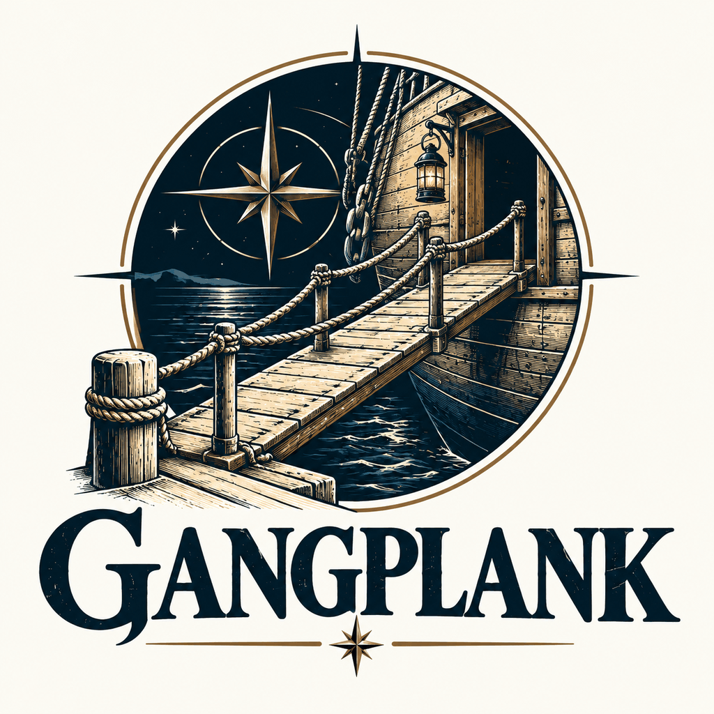

# Gangplank

A browser-first workspace that gets people without Git training safely onto GitHub and GitLab projects, from Windows PowerShell 5.1 and a browser; no git.exe, Node or Python on the workstation. Built to the shared [TechStack](TechStack).

**Engineering preview, not accredited enterprise production software.** See [docs/SECURITY-MODEL.md](docs/SECURITY-MODEL.md) and [docs/ROADMAP.md](docs/ROADMAP.md).

## The name

A gangplank is how people who aren't sailors get aboard a ship without falling in. Gangplank gets people without Git training onto a repository safely. Formerly Keystone (Keystone Workspace, Keystone Enterprise Workspace).

**Upgrading from Keystone.** Everything keeps working:
- `Launch-Keystone.bat` and `Stop-Keystone.ps1` remain as small stubs that forward to `Launch-Gangplank.bat` and `Stop-Gangplank.ps1`. `Stop-Gangplank.ps1` and the launcher's one-instance check also find a Keystone host that is still running.
- On first launch, `%LOCALAPPDATA%\Keystone` (saved session, sealed tokens) is copied once to `%LOCALAPPDATA%\Gangplank`; the original stays as it was. Saved tokens remain readable (same Windows account, same DPAPI seal).
- Workspaces are never moved: if you have `%USERPROFILE%\Keystone` and no `%USERPROFILE%\Gangplank`, Gangplank keeps using the Keystone folder (a folder chosen in Settings is kept as is).
- `KEYSTONE_*` environment variables still work; `GANGPLANK_*` wins when both are set. `KEYSTONE_ARC_PATH` becomes `GANGPLANK_LAZARETTE_PATH` and `KEYSTONE_ARC_ITEM_*` becomes `GANGPLANK_LAZARETTE_ITEM_*`.
- `config\keystone-config.json` and `config\keystone.local.json` keep their names, so local settings and the Lazarette (formerly ARC) setting carry over.
- New work branches are named `gangplank/work-…`; existing `keystone/work-…` branches open, download and save like any other branch.

## Launch
Double-click **Launch-Gangplank.bat**. Gangplank starts a local server on `http://127.0.0.1:8769/` (another free port if that one is taken) and opens your browser with a one-time launch link. The link works once, for two minutes; if you close the tab, press **L** in the Gangplank window for a new link.

- `Launch-Gangplank.bat -NoBrowser [port]` starts without opening a browser (the link is printed).
- `Launch-Gangplank.bat -Cli` opens the classic text menu.
- The server uses a `TcpListener` on 127.0.0.1, so no HttpListener URL reservation or admin rights are needed.
- The batch file uses the same process-scoped `-STA -NoProfile -ExecutionPolicy Bypass` switches as Lazarette and Halyard. They apply only to the launched process and do not change machine policy or override Group Policy or application control.

## Stopping and one instance
**The browser tab owns the server.** Gangplank stops itself about 20 seconds after its last tab closes (5 seconds when the browser reports the tab closing); a reload or a second open tab keeps it running. It never stops while a background task (save, download, review request, AI) is running: it waits for that to finish. Other ways to stop it:
- **End session** at the bottom of the left navigation.
- Ctrl+C in its PowerShell window.
- `powershell.exe -NoProfile -ExecutionPolicy Bypass -File .\Stop-Gangplank.ps1` stops every running Gangplank host, including one in a hidden window, without needing its process ID. Each host gets up to 30 seconds to finish what it is doing before it is killed.

**One instance.** If Gangplank is already running from this folder with the same saved session, the launcher shows it and asks *Stop it and start fresh?* (Enter = yes). `Launch-Gangplank.bat --replace` answers yes without asking; `Launch-Gangplank.bat --stay` keeps the server running after the tab closes. To turn auto-stop off permanently, set `GANGPLANK_AUTO_STOP=0` in the environment or `"AutoStop": false` in `config/keystone-config.json` (`GANGPLANK_AUTO_STOP=1` overrides the config file). Options pass through both launchers, for example `Launch-Gangplank.bat -NoBrowser 19000 --stay`.

**Runtime files.** While it runs, the host writes `Logs\gangplank-server-<pid>.json` (pid, port, url, start time, saved-session folder; never the launch link, cookie or client secret) and deletes it when it stops. The launcher and `Stop-Gangplank.ps1` read these files and delete stale ones whose process has gone.

## Connect → Start → Edit → Smart Save
1. Add a token in **Credentials** (or set an environment variable), paste a GitHub or GitLab project URL and connect.
2. Optionally name your branch (for example `dummy-dev`), then **Start my safe workspace**. Gangplank creates that branch from the default branch and downloads it to `%USERPROFILE%\Gangplank\<repository>\<branch>`, like a normal clone (change the folder in **Settings**). Existing folders are never overwritten. To just look at an existing branch, use **Explore this branch**.
3. Edit files with your normal tools.
4. In **Smart Save**, refresh and choose which added or modified files to publish. Deletions start unselected; likely secrets and files over 5 MB are blocked.
5. Accept the generated commit title (or ask the AI for one from file names only) and publish.
6. **Create review request** opens a GitHub pull request or GitLab merge request.

Gangplank pins each download to a commit, checks the remote branch before saving and never force-updates a branch: if someone else changed it, saving stops. File modes are kept (scripts stay executable). Direct saves to the default branch are off unless `GANGPLANK_ALLOW_DEFAULT_BRANCH_WRITES=1`.

Your project, work branch and download baseline are saved in `%LOCALAPPDATA%\Gangplank`, so restarting Gangplank keeps pending work. Workspaces never live inside the Gangplank program folder (an older `work\` folder there is still ignored by Git and its session is picked up once). Downloads, saves, reviews and AI answers run in the background; the page stays usable and shows progress.

## Credentials
Gangplank looks for a token in this order:
1. **Environment:** `GITHUB_TOKEN`, `GITLAB_TOKEN`, `GANGPLANK_AI_TOKEN` or `GENAI_TOKEN`.
2. **Saved in Gangplank:** paste a token once in **Credentials**. It is sealed with Windows DPAPI for your Windows account in `%LOCALAPPDATA%\Gangplank\credentials.json`, never shown again and never sent back to the browser. Remove it there at any time.
3. **Lazarette**, only if you turn it on (below).

Only HTTPS github.com, web.git.mil and administrator-approved `GANGPLANK_GITLAB_ALLOWED_HOSTS` are accepted for repositories. Provider errors are reported as codes (`AUTH_REJECTED`, `FORBIDDEN`, `NOT_FOUND`, `RATE_LIMITED`...); response bodies stay in the local log.

## Lazarette (optional, opt-in)
Lazarette is still in development, so Gangplank never looks for it on its own. To use it, open **Credentials → Lazarette vault**, tick **Use Lazarette**, enter the Lazarette folder (the one containing `lib\Lazarette.ps1`, or `lib\Arc.ps1` in an older ARC 5 checkout) and restart Gangplank; or set `GANGPLANK_LAZARETTE_PATH` (the former `KEYSTONE_ARC_PATH` still works). Like before the rename, the generic `LAZARETTE_PATH` / `ARC_PATH` variables and sibling folders are not searched: Lazarette stays opt-in. Settings are stored in `config\keystone.local.json` (not committed).

When Lazarette is on, Gangplank loads it once at startup and runs Lazarette's own unlock (`Unlock-LazaretteVaultInteractive`, or `Unlock-ArcVaultInteractive` on a Lazarette that still uses the ARC names: passphrase or CAC PIN, then authenticator) in the Gangplank PowerShell window, before the server starts. It then reads items with `Get-LazaretteSecret` (or `Get-ArcSecret`) (defaults: `github`, `gitmil`, `genapi`; change the mapping in Credentials). Gangplank has no unlock code of its own and never unlocks from a browser request. Older ARC 3/4 installs (`pm.ps1`) are still supported.

## AI model
Open **Settings → AI model**, enter your organisation's endpoint and select **Detect models**. Gangplank asks the endpoint what it is and which chat models it offers, filters out embedding, speech and image models, and preselects the best match; **Test** sends one short message to prove it works. Supported:

| Kind | Recognised by | Notes |
|---|---|---|
| OpenAI-compatible (genai.mil, OpenAI, LiteLLM, LM Studio, vLLM) | `/v1/models` answers | Bearer token, streaming |
| Azure OpenAI | `*.openai.azure.com` | `api-key` header; models are your deployments |
| Databricks model serving | `/serving-endpoints` or a Databricks host | Chat endpoints only; answers arrive in one piece |
| Ollama on this PC | `/api/tags` (port 11434) | No token needed; plain http allowed for this PC only |

The token is the **GenAI** credential (Settings, or `GANGPLANK_AI_TOKEN` / `GENAI_TOKEN`). The environment names Halyard uses also work, so one setup serves both apps: `LLM_URL` or `OPENAI_BASE_URL`, `LLM_MODEL` or `OPENAI_MODEL`, `LLM_TOKEN` or `OPENAI_API_KEY`. With nothing configured, Gangplank uses `https://api.genai.mil/v1` and `gemini-3.8-flash`. Endpoints must be HTTPS; if `GANGPLANK_AI_ALLOWED_HOSTS` is set, only those hosts (and genai.mil) are allowed.

The assistant is advisory only: it cannot change files, run tools or publish. Chat sends your typed text and the project/branch name; commit-title help sends file names and statuses only. Source code is never sent automatically.

## Audit
Every remote write (branch, commit, review request) and every credential or Lazarette setting change is recorded in `Logs\audit.jsonl` and shown under **Credentials → Recent changes**: what, where and when, never contents or tokens.

## Development
- **LocalDev** (development PCs only): `Launch-LocalDev.bat` runs the real host in test mode against a synthetic GitHub (`dev/fake-github.mjs`, needs Node.js). See [LOCAL-DEV.md](LOCAL-DEV.md).
- **Tests:** `tests\*.Tests.ps1` (Windows PowerShell 5.1), `node --test tests/e2e/host.e2e.mjs` (real host against the synthetic GitHub), `node --test tests/e2e/browser.e2e.mjs` (the UI in a real browser; needs Playwright), `node --test dev/fake-github.test.mjs`, `node tests/BrowserSyntax.Tests.cjs`. CI runs all of them on the Windows runner.

## Source layout
| Path | What |
|---|---|
| `Start-Gangplank.ps1`, `Launch-Gangplank.bat` | Entry point and launcher |
| `Stop-Gangplank.ps1`, `Core/Lifecycle.ps1`, `web/heartbeat-worker.js` | Lifecycle: tab presence (heartbeat), auto-stop, runtime files, finding and stopping running hosts |
| `Server/` | Local server (`Http.ps1`), API (`Routes.ps1`), background jobs (`Jobs.ps1`, `JobWork.ps1`), saved session (`Session.ps1`) |
| `Core/` | Workspace and Smart Save, Sentinel, HTTP transport, credentials, audit, AI (`Intelligence.ps1`: endpoint discovery), logging |
| `Providers/` | GitHub and GitLab REST adapters |
| `LazaretteBridge.ps1` | Optional Lazarette integration |
| `web/` | Browser UI (`index.html`, `app.js`, `app.css`) |
| `dev/` | LocalDev, the synthetic GitHub and a synthetic AI gateway |
| `Gangplank.ps1` | Classic text menu |

## Important limits
- The browser flow needs an existing, initialised remote branch; bootstrapping an empty repository is a future feature.
- Secret detection is pattern-based for common credential files and formats; it is not complete DLP.
- Enterprise SSO, RBAC, signing and formal security authorization are future milestones.
