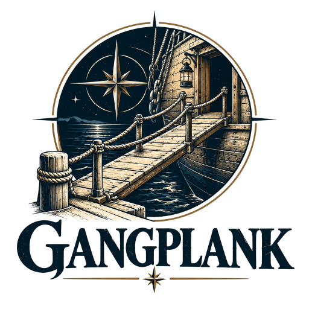
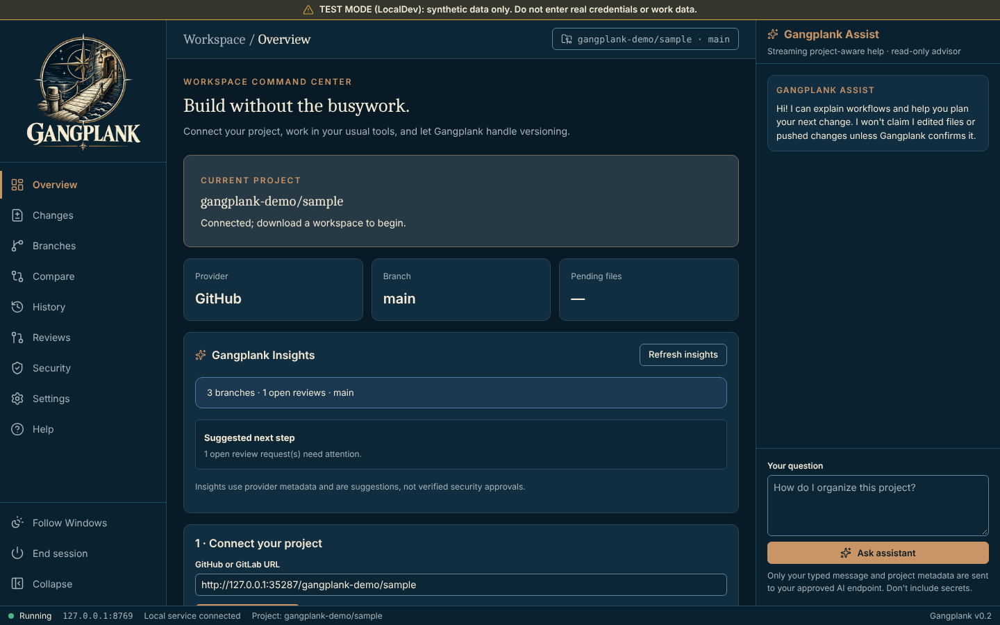
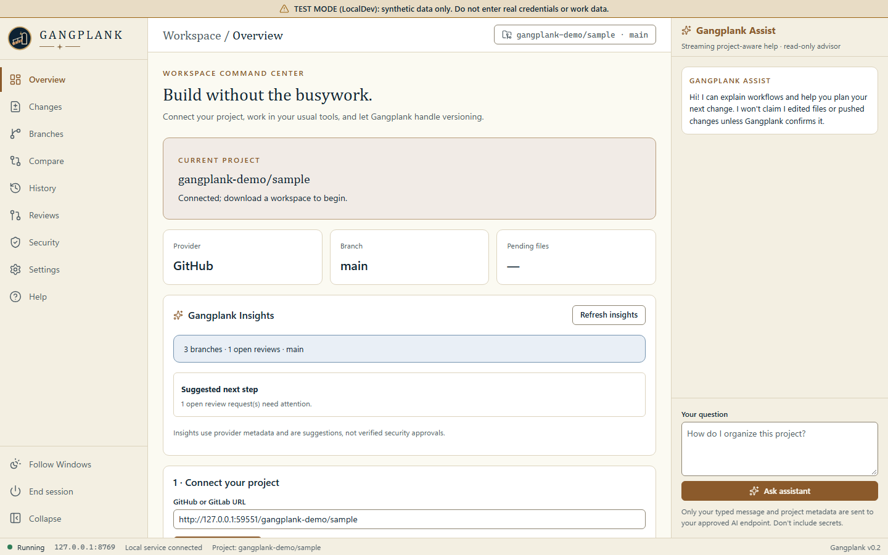

  <picture>
    <source media="(prefers-color-scheme: dark)" srcset="assets/brand/emblem-dark-transparent.png">
    
  </picture>

# Gangplank

A browser-first workspace that gets people without Git training safely onto GitHub and GitLab projects, from Windows PowerShell 5.1 and a browser; no git.exe, Node or Python on the workstation. Built to the shared [TechStack](TechStack).

**Engineering preview, not accredited enterprise production software.** See [docs/SECURITY-MODEL.md](docs/SECURITY-MODEL.md) and [docs/ROADMAP.md](docs/ROADMAP.md).

## The name

A gangplank is how people who aren't sailors get aboard a ship without falling in. Gangplank gets people without Git training onto a repository safely.

Data saved under the former name (`%LOCALAPPDATA%\Keystone`, `%USERPROFILE%\Keystone`) is not picked up automatically; move it by hand once to `%LOCALAPPDATA%\Gangplank` and `%USERPROFILE%\Gangplank`.

| Night watch (dark) | Chart room (light) |
| --- | --- |
|  |  |

Gangplank follows the Windows light or dark setting. The theme button at the bottom of the sidebar switches between Follow Windows, Night watch and Chart room, and Gangplank remembers the choice.

## Launch
Double-click **Launch-Gangplank.bat**. Gangplank starts a local server on `http://127.0.0.1:8769/` (another free port if that one is taken) and opens your browser with a one-time launch link. The link works once, for two minutes; if you close the tab, press **L** in the Gangplank window for a new link.

- `Launch-Gangplank.bat -NoBrowser [port]` starts without opening a browser (the link is printed).
- `Launch-Gangplank.bat -Cli` opens the classic text menu.
- The server uses a `TcpListener` on 127.0.0.1, so no HttpListener URL reservation or admin rights are needed.
- The batch file uses the same process-scoped `-STA -NoProfile -ExecutionPolicy Bypass` switches as Lazarette and Halyard. They apply only to the launched process and do not change machine policy or override Group Policy or application control.

## Stopping and one instance
**The browser tab owns the server.** Gangplank stops itself about 20 seconds after its last tab closes (5 seconds when the browser reports the tab closing); a reload or a second open tab keeps it running. It never stops while a background task (save, download, review request, AI) is running: it waits for that to finish. Other ways to stop it:
- **End session** at the bottom of the left navigation.
- Ctrl+C in its PowerShell window.
- `powershell.exe -NoProfile -ExecutionPolicy Bypass -File .\Stop-Gangplank.ps1` stops every running Gangplank host, including one in a hidden window, without needing its process ID. Each host gets up to 30 seconds to finish what it is doing before it is killed.

**One instance.** If Gangplank is already running from this folder with the same saved session, the launcher shows it and asks *Stop it and start fresh?* (Enter = yes). `Launch-Gangplank.bat --replace` answers yes without asking; `Launch-Gangplank.bat --stay` keeps the server running after the tab closes. To turn auto-stop off permanently, set `GANGPLANK_AUTO_STOP=0` in the environment or `"AutoStop": false` in `config/gangplank-config.json` (`GANGPLANK_AUTO_STOP=1` overrides the config file). Options pass through both launchers, for example `Launch-Gangplank.bat -NoBrowser 19000 --stay`.

**Runtime files.** While it runs, the host writes `Logs\gangplank-server-<pid>.json` (pid, port, url, start time, saved-session folder; never the launch link, cookie or client secret) and deletes it when it stops. The launcher and `Stop-Gangplank.ps1` read these files and delete stale ones whose process has gone.

## Connect → Start → Edit → Smart Save
1. Add a token in **Credentials** (or set an environment variable), paste a GitHub or GitLab project URL and connect.
2. Optionally name your branch (for example `dummy-dev`), then **Start my safe workspace**. Gangplank creates that branch from the default branch and downloads it to `%USERPROFILE%\Gangplank\<repository>\<branch>`, like a normal clone (change the folder in **Settings**). Existing folders are never overwritten. To just look at an existing branch, use **Explore this branch**.
3. Edit files with your normal tools.
4. In **Smart Save**, refresh and choose which added or modified files to publish. Deletions start unselected; likely secrets and files over 5 MB are blocked.
5. Accept the generated commit title (or ask the AI for one from file names only) and publish.
6. **Create review request** opens a GitHub pull request or GitLab merge request.

Gangplank pins each download to a commit, checks the remote branch before saving and never force-updates a branch: if someone else changed it, saving stops. File modes are kept (scripts stay executable). Direct saves to the default branch are off unless `GANGPLANK_ALLOW_DEFAULT_BRANCH_WRITES=1`.

Your project, work branch and download baseline are saved in `%LOCALAPPDATA%\Gangplank`, so restarting Gangplank keeps pending work. Workspaces never live inside the Gangplank program folder (an older `work\` folder there is still ignored by Git and its session is picked up once). Downloads, saves, reviews and AI answers run in the background; the page stays usable and shows progress.

## Credentials
Gangplank looks for a token in this order:
1. **Environment:** `GITHUB_TOKEN` or `GITLAB_TOKEN`.
2. **Saved in Gangplank:** paste a token once in **Credentials**. It is sealed with Windows DPAPI for your Windows account in `%LOCALAPPDATA%\Gangplank\credentials.json`, never shown again and never sent back to the browser. Remove it there at any time.
3. **Lazarette**, only if you turn it on (below).

Only HTTPS github.com, your organization's GitLab host (`GANGPLANK_GITLAB_HOST`, or `GitLabHost` in `config\gangplank-config.json`; none by default) and administrator-approved `GANGPLANK_GITLAB_ALLOWED_HOSTS` are accepted for repositories. Provider errors are reported as codes (`AUTH_REJECTED`, `FORBIDDEN`, `NOT_FOUND`, `RATE_LIMITED`...); response bodies stay in the local log.

## Lazarette (optional, opt-in)
Reference for the bridge, what it reads and what it never does: [docs/LAZARETTE-BRIDGE.md](docs/LAZARETTE-BRIDGE.md).

Lazarette is still in development, so Gangplank never looks for it on its own. To use it, open **Credentials → Lazarette vault**, tick **Use Lazarette**, enter the Lazarette folder (the one containing its engine loader, `lib\Lazarette.ps1`) and restart Gangplank; or set `GANGPLANK_LAZARETTE_PATH`. The generic `LAZARETTE_PATH` variable and sibling folders are not searched: Lazarette stays opt-in. Settings are stored in `config\gangplank.local.json` (not committed).

When Lazarette is on, Gangplank loads it once at startup and runs Lazarette's own unlock (`Unlock-LazaretteVaultInteractive`: passphrase or smart card PIN, then authenticator) in the Gangplank PowerShell window, before the server starts. It then reads items with `Get-LazaretteSecret`. By default it reads one item each for GitHub, GitLab and the AI model; Credentials shows the item names and lets you change the mapping. Gangplank has no unlock code of its own and never unlocks from a browser request.

## AI through Fairlead

Every AI request goes to [Fairlead](https://github.com/fleethacker-data-crucible/Fairlead), the Fleet model router on this PC, at `http://127.0.0.1:8776/v1/chat/completions`, asking for the route `auto`. Gangplank holds no gateway address, provider token or model id of its own, and it only talks to a loopback address.

- **Key:** Fairlead gives Gangplank its own client key. In Fairlead open **Clients** and install a key for **Gangplank**; Fairlead saves it in Windows Credential Manager as the generic credential `Fairlead/Gangplank` for your Windows account. Gangplank reads it from there when it needs it, sends it as a bearer token with `X-Fairlead-Label: Gangplank`, and never shows it or sends it to the browser. There is no environment variable or vault item for it. Without the key, AI features say "Open Fairlead and install a key for Gangplank".
- **Privacy:** every request carries `X-Fairlead-Privacy: local`, so Fairlead keeps it on local models.
- **Settings:** **Settings → AI through Fairlead** shows the route, the address, and whether the key is installed; **Test** sends one short message through Fairlead. `GANGPLANK_FAIRLEAD_URL` (loopback only) and `GANGPLANK_FAIRLEAD_MODEL` change the address and route name.

The assistant is advisory only: it cannot change files, run tools or publish. Chat sends your typed text and the project/branch name; commit-title help sends file names and statuses only. Source code is never sent automatically.

## Audit
Every remote write (branch, commit, review request) and every credential or Lazarette setting change is recorded in `Logs\audit.jsonl` and shown under **Credentials → Recent changes**: what, where and when, never contents or tokens.

## Development
- **LocalDev** (development PCs only): `Launch-LocalDev.bat` runs the real host in test mode against a synthetic GitHub (`dev/fake-github.mjs`, needs Node.js). See [LOCAL-DEV.md](LOCAL-DEV.md).
- **Tests:** `tests\*.Tests.ps1` (Windows PowerShell 5.1), `node --test tests/e2e/host.e2e.mjs` (real host against the synthetic GitHub), `node --test tests/e2e/browser.e2e.mjs` (the UI in a real browser; needs Playwright), `node --test dev/fake-github.test.mjs`, `node tests/BrowserSyntax.Tests.cjs`. CI runs all of them on the Windows runner.

## Source layout
| Path | What |
|---|---|
| `Start-Gangplank.ps1`, `Launch-Gangplank.bat` | Entry point and launcher |
| `Stop-Gangplank.ps1`, `Core/Lifecycle.ps1`, `web/heartbeat-worker.js` | Lifecycle: tab presence (heartbeat), auto-stop, runtime files, finding and stopping running hosts |
| `Server/` | Local server (`Http.ps1`), API (`Routes.ps1`), background jobs (`Jobs.ps1`, `JobWork.ps1`), saved session (`Session.ps1`) |
| `Core/` | Workspace and Smart Save, Sentinel, HTTP transport, credentials, audit, AI (`Intelligence.ps1`: endpoint discovery), logging |
| `Providers/` | GitHub and GitLab REST adapters |
| `LazaretteBridge.ps1` | Optional Lazarette integration |
| `web/` | Browser UI (`index.html`, `app.js`, `app.css`; `shell.js` for theme and sidebar; `icons.js`, Lucide icons generated by `tools/gen-icons.mjs`; `vendor/fleet/fleet.css`, the shared Fleet UI styles) |
| `dev/` | LocalDev, the synthetic GitHub, a synthetic AI gateway and the README screenshot capture (`capture-screenshots.mjs`) |
| `Gangplank.ps1` | Classic text menu |

## Privacy and data

Gangplank runs on this PC and serves its page on `127.0.0.1` only. Data leaves the machine only where you set it up:

- **Your Git host.** Downloads and saves go to and from github.com or your allowlisted GitLab host, using your token.
- **The AI model.** An AI request sends your question and the project content it includes to the configured endpoint. The default is the Fleet router on this PC, and Gangplank asks it to keep every request on local models, so nothing leaves; if you point Gangplank at a cloud or organization endpoint, that provider's terms and your organization's AI policy apply.

Tokens are sealed with DPAPI for your Windows account and never sent to the browser. The audit log records what changed and where, never file contents or tokens. Gangplank sends no usage data anywhere.

## Important limits
- The browser flow needs an existing, initialised remote branch; bootstrapping an empty repository is a future feature.
- Secret detection is pattern-based for common credential files and formats; it is not complete DLP.
- Enterprise SSO, RBAC, signing and formal security authorization are future milestones.
