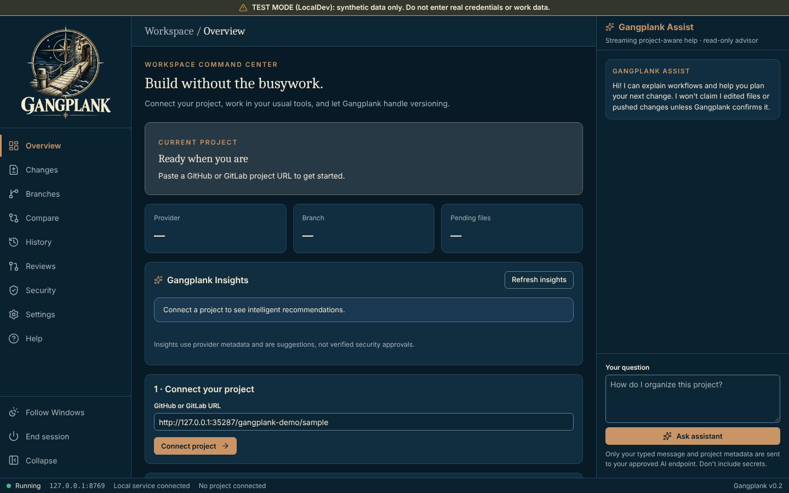
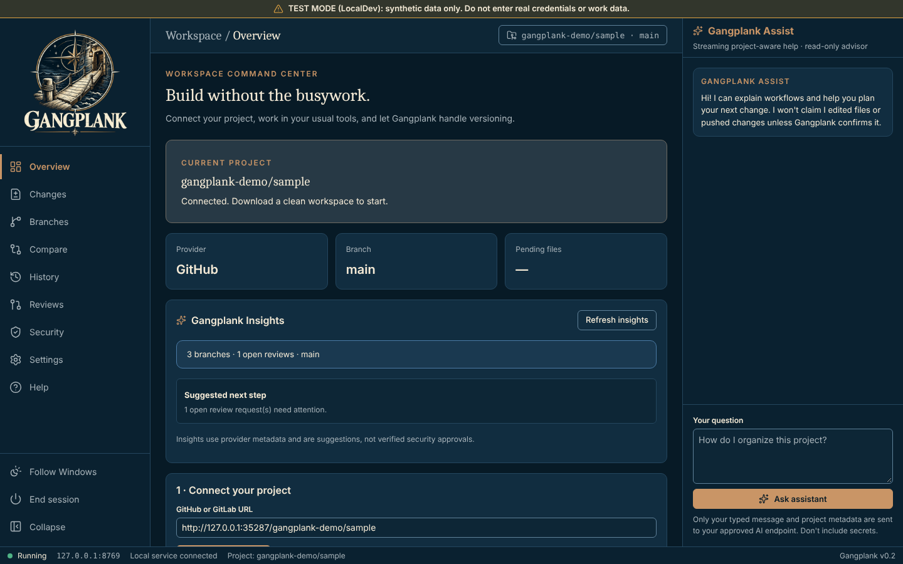
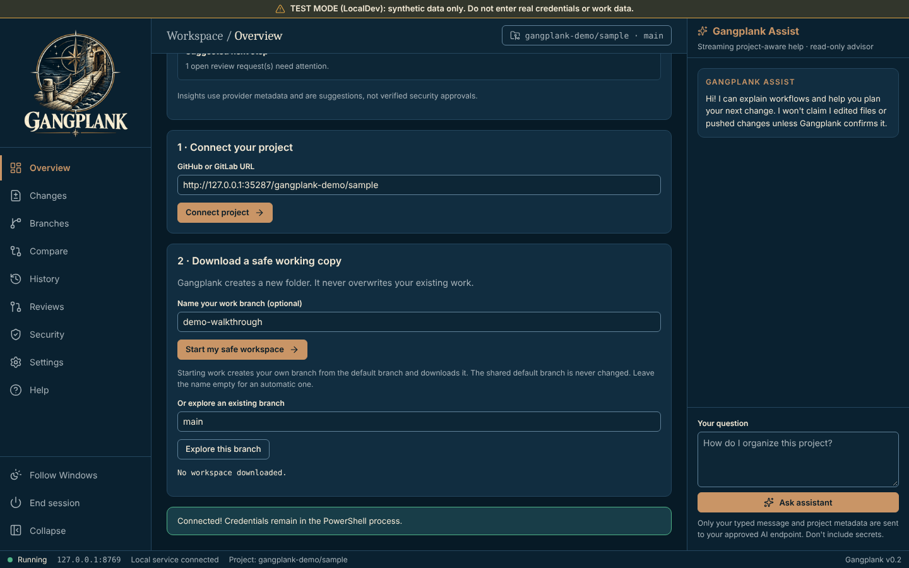
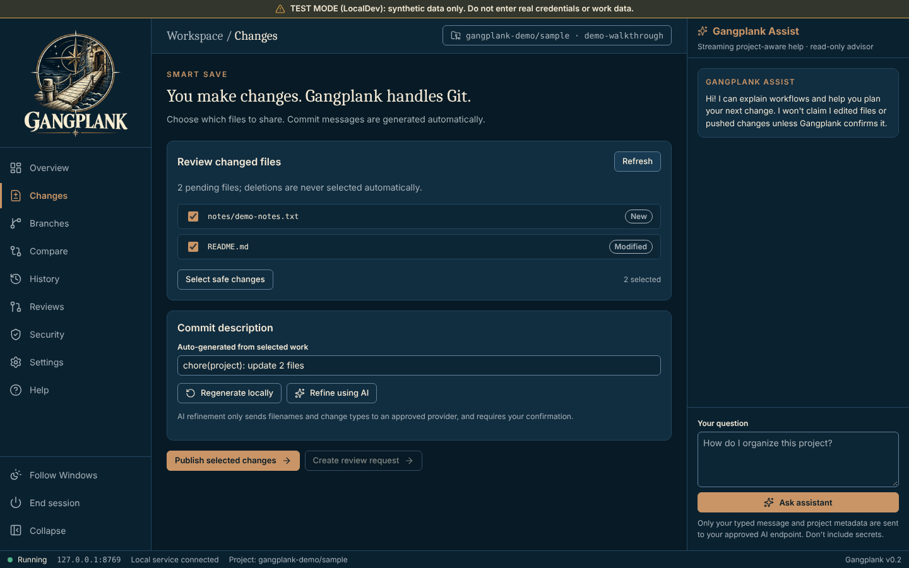
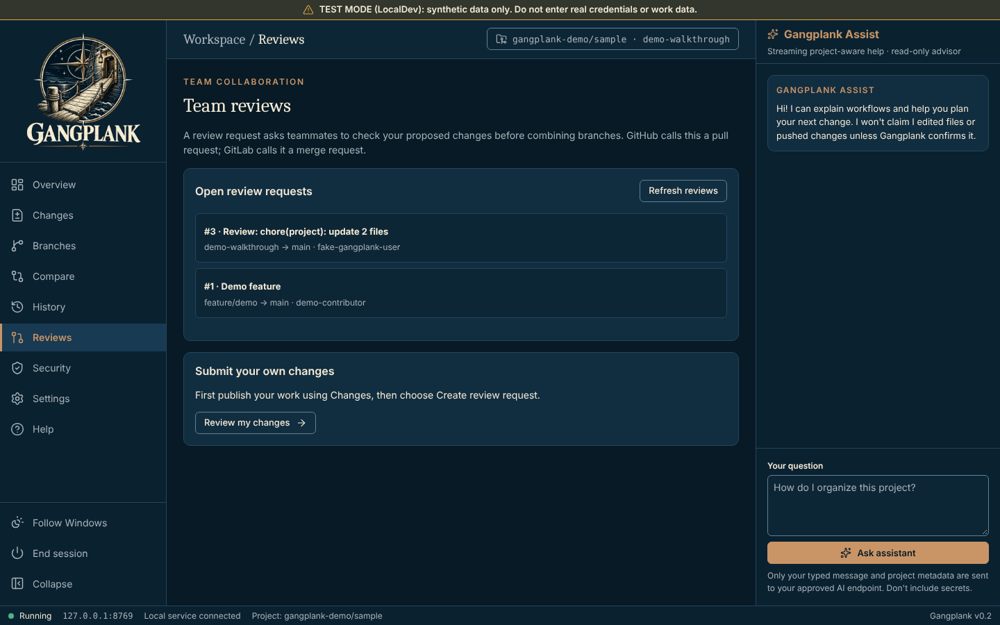
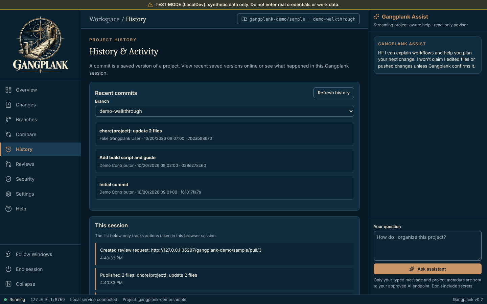
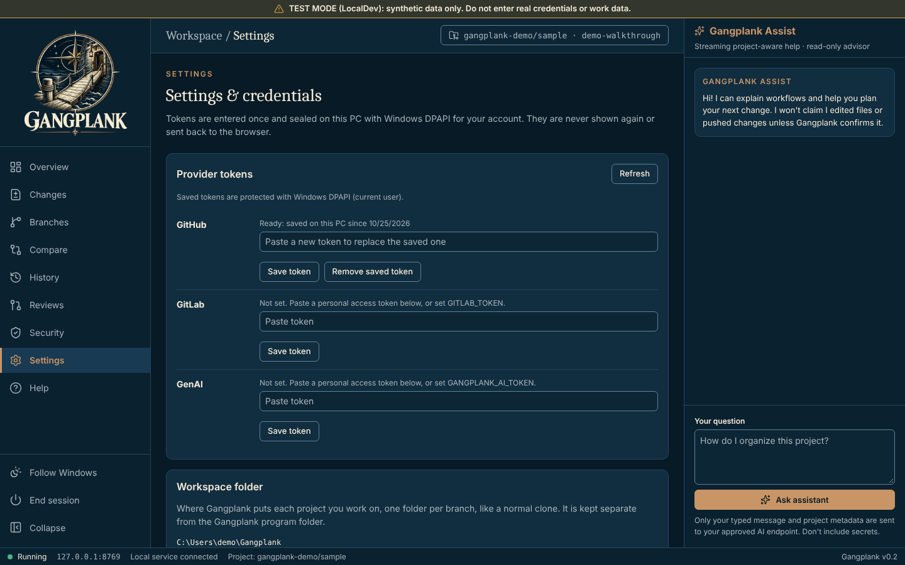

# Gangplank walkthrough

Get a safe working copy of a project, edit it with your normal tools, and publish your changes for review, with no Git commands.

> **Screenshots:** captured with demo data and scanned by the Chief of Staff (team directive 10).

## Before you start

- Windows PowerShell 5.1 (part of Windows). No administrator rights and no installer.
- Microsoft Edge or Google Chrome.
- Launch: Double-click `Launch-Gangplank.bat` (serves `http://127.0.0.1:8769/` and opens the browser with a one-time link).
- A GitHub or GitLab token saved in **Credentials**, or set in the environment.

## Steps

### 1. First launch

Gangplank opens on **Overview**. With no project connected, the *Current project* card says *Ready when you are*. Scroll to step 1, *Connect your project*. The TEST MODE banner across the top marks the LocalDev demo build.

### 2. Connect your project

Paste the project URL and connect. Gangplank shows the project and its default branch.

### 3. Start a safe workspace

Name your branch and select **Start my safe workspace**. Gangplank creates the branch and downloads it to your Gangplank folder.

### 4. Review your changes

After editing files, open **Changes** (*Smart Save*) and select **Refresh**. Choose which added or modified files to publish; deletions are never selected automatically.

### 5. Ask for a review

Publish, then select **Create review request** to open a pull request or merge request.

### 6. See what happened

**History & Activity** shows recent commits and everything done in this session.

### 7. Manage credentials

**Settings & credentials** shows which tokens are saved, never their values, plus the workspace folder and AI model.

*This is the TEST MODE demo build, so the saved GitHub token shown here is simulated.*

## About these images

Images live in [`docs/assets/walkthrough/`](../assets/walkthrough/), named `NN-<screen>.png` after the step they belong to. They are 1440x900 at 100% scale in the Night watch (dark) theme with the sidebar expanded, and show demo data only. `node dev/capture-walkthrough.mjs` retakes them (and the README pair in `docs/screenshots/`) against the synthetic GitHub in `dev/fake-github.mjs`.
